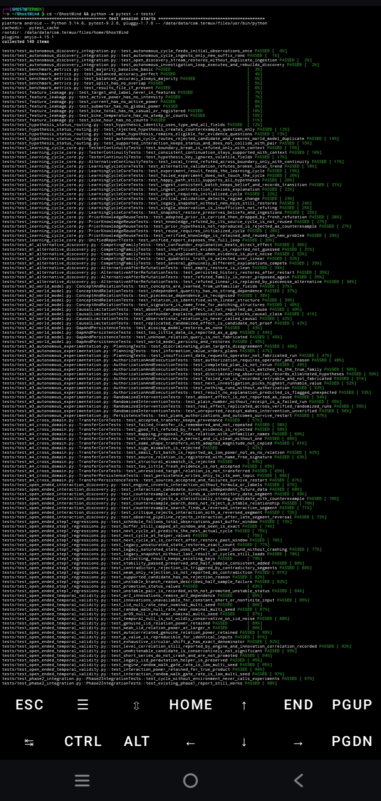
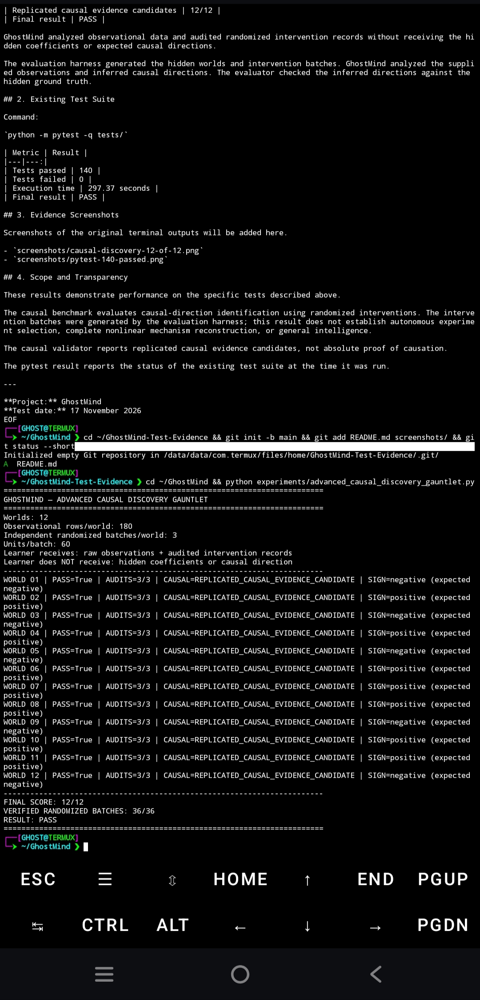

# GhostMind — Experimental Test Results

**An experimental demonstration of causal discovery and software reliability.**

## 1. Advanced Causal Discovery Gauntlet

| Metric | Result |
|---|---:|
| Hidden randomized worlds | 12 |
| Correct causal directions | 12/12 |
| Randomized intervention batches | 36/36 verified |
| Replicated causal evidence candidates | 12/12 |
| Final result | PASS |

GhostMind analyzed observational data and audited randomized intervention records without receiving the hidden coefficients or expected causal directions.

The evaluation harness generated the hidden worlds and intervention batches. GhostMind analyzed the supplied observations and inferred causal directions. The evaluator checked the inferred directions against the hidden ground truth.

## 2. Existing Test Suite

Command:

`python -m pytest -q tests/`

| Metric | Result |
|---|---:|
| Tests passed | 140 |
| Tests failed | 0 |
| Execution time | 297.37 seconds |
| Final result | PASS |

## 3. Evidence Screenshots

The original terminal test outputs are shown below.

## 4. Scope and Transparency

These results demonstrate performance on the specific tests described above.

The causal benchmark evaluates causal-direction identification using randomized interventions. The intervention batches were generated by the evaluation harness; this result does not establish autonomous experiment selection, complete nonlinear mechanism reconstruction, or general intelligence.

The causal validator reports replicated causal evidence candidates, not absolute proof of causation.

The pytest result reports the status of the existing test suite at the time it was run.

---

**Project:** GhostMind  
**Test date:** 17 November 2026
